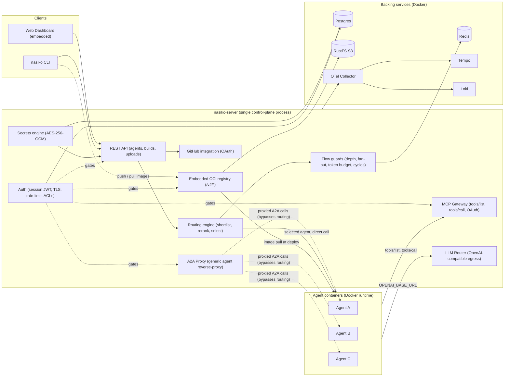

**Nasiko is the OpenRuntime for agents, coding harnesses, frameworks and tools.**<br />
Find the coding agents already running. See what each one costs, by harness and model. Route them to the models you choose while developers keep using their existing harness workflows. Then deploy your own agents on the same runtime, with tools, policy and human approval built in.

**[📚 Documentation](https://docs.nasiko.com)**  •  **[💬 Discord](https://discord.com/invite/HmnfkTfjFv)**  •  **[🐛 Report a bug](https://github.com/Nasiko-Labs/nasiko/issues)**

[](https://github.com/Nasiko-Labs/nasiko/stargazers)
[](https://github.com/Nasiko-Labs/nasiko/network/members)
[](https://github.com/Nasiko-Labs/nasiko/releases)
[](https://github.com/Nasiko-Labs/nasiko/blob/main/LICENSE)

[](https://github.com/Nasiko-Labs/nasiko)
[](https://github.com/Nasiko-Labs/nasiko/issues)
[](https://github.com/Nasiko-Labs/nasiko/pulls)
[](https://github.com/Nasiko-Labs/nasiko/actions)
[](https://github.com/Nasiko-Labs/nasiko/pulls)

## Table of Contents

- [What is Nasiko?](#what-is-nasiko)
- [Features](#features)
- [Why this runs in the call path](#why-this-runs-in-the-call-path)
- [Architecture](#architecture)
- [Get started](#get-started)
- [Coding agents: discover, report, route](#coding-agents-discover-report-route)
- [Deploying your own agents](#deploying-your-own-agents)
- [Environment variables](#environment-variables)
- [Troubleshooting](#troubleshooting)
- [Project activity](#project-activity)
- [Documentation and links](#documentation-and-links)
- [Support](#support)
- [Contributing](#contributing)
- [License](#license)

## What is Nasiko?

Your developers are already running coding agents. Claude Code, Codex, Cursor, OpenCode, often
more than one at a time, each with its own dashboard and its own billing unit. At the end of the
month there is a real bill, and nobody can say who spent it, on which model, or what it produced.

Nasiko finds those agents, puts their spend in one schema, and hands back the model choice the
harness made for you. The same runtime then deploys and governs the agents you build yourself:
any A2A agent, with tools through one MCP gateway, permissions for agents as well as people, and
human approval where it matters. An OpenRuntime belongs to no vendor inside it: your cost history,
your policy and your model choice stay with you rather than with whichever harness you happened to
install.

Two properties hold the rest of this together, and they are not the same thing.

**Non-invasive discovery** is about your architecture. Nasiko detects the harnesses you already
run without changing their configuration. Reporting and routing are explicit opt-ins that add hooks
or update harness settings, but they require no wrapper or SDK in your application code.

**Non-intrusive operation** is about your day. After one-time setup, developers keep using the same
harness commands and interfaces. OpenCode must be restarted after its plugin is installed, and
Codex asks you to trust the new Nasiko hooks.

<br />
**Nasiko Dashboard**: see coding-agent sessions and spend, deploy agents, route traffic, manage
tools, and watch traces.

## Features

Three things break first when an agent estate grows: spend nobody can attribute, permissions nobody
can enumerate, and a fleet nobody can run as one system. The feature set is grouped accordingly,
starting with the coding agents you already have.

### Coding agents

| Feature                | What it does                                                                                                                              |
| ---------------------- | ----------------------------------------------------------------------------------------------------------------------------------------- |
| **Discovery**          | `nasiko agents discover` finds Claude Code, Codex, OpenCode and Cursor CLI on a machine. Read-only: no account, no server, nothing sent. |
| **Session reporting**  | Hooks report each completed turn, so sessions, tokens and cost appear in one dashboard. Past sessions are imported too.                   |
| **Model routing**      | Point a harness at Nasiko instead of its vendor. Claude Code can run on your OpenAI key; the harness never holds the real key.            |

### TokenOps

| Feature                        | What it does                                                                                                                                                                                    |
| ------------------------------ | ----------------------------------------------------------------------------------------------------------------------------------------------------------------------------------------------- |
| **LLM Router**                 | Agents get an `OPENAI_BASE_URL` and a short-lived identity token instead of a real key. The router resolves provider, model, and key server-side. No agent and no log ever sees a real API key. |
| **Cost and token attribution** | Usage and cost are collected from `gen_ai.*` span attributes and broken out per agent and per model, rather than arriving as a single provider invoice you have to reverse-engineer.            |
| **One trace per interaction**  | Every dispatch and proxy hop emits a real OTel span, so a request is one end-to-end trace across every agent hop, with cost attached.                                                           |

### Policy, security, and governance

| Feature                                          | What it does                                                                                                                                                                                                     |
| ------------------------------------------------ | ---------------------------------------------------------------------------------------------------------------------------------------------------------------------------------------------------------------- |
| **Single ingress, always proxied**               | Agents are never publicly reachable. Every agent-to-agent call is proxied through the server, so limits and tracing apply at every hop rather than only the first.                                               |
| **Access control, for agents as well as people** | User-to-agent ownership and grants, plus an agent-to-agent allowlist. The two gate every proxy call independently.                                                                                               |
| **MCP Gateway**                                  | One permanent URL gives every agent a merged, permission-filtered view of Composio toolkits and custom MCP servers, without the agent ever holding the credentials. An agent discovers only what it was granted. |
| **Human in the loop**                            | Set a tool to **ask** and the agent pauses until someone approves it. Agents can also pause to ask a question, then resume the same task with the answer.                                                       |
| **Flow guards**                                  | Redis-backed cascade limits (depth, fan-out, token budget, timeout, cycle detection) stop a loop between two agents from quietly consuming your budget.                                                          |
| **Encrypted secrets**                            | Per-agent secrets are encrypted at rest with AES-256-GCM and injected only at deploy time, so they stay out of your repo.                                                                                        |

### Orchestration

| Feature                             | What it does                                                                                                                                                     |
| ----------------------------------- | ---------------------------------------------------------------------------------------------------------------------------------------------------------------- |
| **Deploy anything that speaks A2A** | `nasiko deploy` builds, pushes to the embedded registry, and runs it. No external registry required, and no SDK to adopt.                                        |
| **Intelligent routing engine**      | A 3-stage pipeline: shortlist by embedding similarity, rerank on conversation context, then an LLM makes the final pick. Callers do not need to know your fleet. |
| **Embedded OCI registry**           | Self-hosted, S3-backed, with layer dedup, so `nasiko push` and `nasiko deploy` need nothing external.                                                            |
| **CLI-first, no lock-in**           | `nasiko new`, `run`, `chat`, `deploy`. Bring your own LLM provider, and change it later.                                                                         |

## Why this runs in the call path

There is no version of this that works from the outside, and saying so plainly is the shortest way
to explain the architecture below.

Every coding-agent vendor meters in its own private unit, and none of them offers an ingest
endpoint for another vendor's usage. There is no invoice reconciliation that produces one number,
and no procurement policy that produces one either. To attribute spend across vendors you have to
be in the path where the calls happen.

Enforcement has the same shape. A budget cap or a tool allowlist is only real if it sits where the
request goes, rather than in a review meeting or in an environment variable a developer can unset.

That constraint is what the next section is a picture of.

## Architecture

Nasiko is a **single process** with no separate gateway. Every inter-agent call is proxied back
through the server, the single chokepoint where flow limits, ACLs, and observability are enforced.
Durable state lives in **Postgres**, **Redis**, and **S3** (RustFS), with optional observability via
**Tempo / Loki / the OTel Collector**.



> Every request to an agent is either dispatched by the routing engine or proxied generically, and both
> paths originate **inside** the server. Agents never receive a direct, public request, and both call
> back out into the LLM Router and MCP Gateway rather than holding real API keys or tool credentials.

## Get started

| You need                                             | For                                                         |
| ---------------------------------------------------- | ----------------------------------------------------------- |
| Nothing but the CLI                                  | Discovering coding agents on a machine                      |
| [Docker](https://docs.docker.com/get-docker/) with Compose V2 (`docker compose`, not the legacy `docker-compose`) | Running the server and dashboard |
| [Rust](https://rustup.rs) 1.85+                      | Only to build the CLI or server from source                 |

### 1. Install the CLI

```sh
# macOS and Linux
curl -fsSL https://registry.nasiko.dev/r/nasiko/install | bash

# Windows (PowerShell)
irm https://registry.nasiko.dev/r/nasiko/install-ps1 | iex
```

Check it with `nasiko --version`. Installer options (version pinning, install folder, mirrors) are
in [Install and connect](https://docs.nasiko.com/install).

**Or build from source** with Rust 1.85+: `cargo install --path cli/ --force` from a clone of this
repo. Cargo puts the binary in `~/.cargo/bin`.

You can already run `nasiko agents discover` now, before any server exists. See
[Discover](#discover).

### 2. Run the server with Docker Compose

```sh
git clone https://github.com/Nasiko-Labs/nasiko.git && cd nasiko
cp .env.example .env        # Windows PowerShell: Copy-Item .env.example .env
docker compose up -d
```

This builds the server image and starts the full stack:
**Postgres · Redis · RustFS (S3) · OTel Collector · Tempo · Loki · nasiko-server**. The first
build compiles Rust inside Docker and takes a few minutes; later builds are fast.

Open **[http://localhost:8080](http://localhost:8080)** and log in with `ADMIN_USERNAME` /
`ADMIN_PASSWORD` (default `admin` / `changeme`).

**About `.env`.** The template's development values work as-is on your own machine. Before anyone
else can reach the server, replace them:

- `SECRETS_ENCRYPTION_KEY`: `openssl rand -base64 32`. Keep it once set; existing secrets can't be
  decrypted with a new key.
- `JWT_SECRET` and `AGENT_JWT_SECRET`: two **different** values from `openssl rand -base64 48`.
  `AGENT_JWT_SECRET` signs the short-lived tokens coding agents and deployed agents use for routing.
- `ADMIN_PASSWORD`: anything but `changeme`.

Set `OPENAI_API_KEY` for features that call a model with the server's default configuration, such
as dashboard chat, the routing engine and deployed agents. The dashboard loads without it.

Compose sets the infrastructure and telemetry URLs (`DATABASE_URL`, `REDIS_URL`, `S3_ENDPOINT`,
`MCP_GATEWAY_PUBLIC_URL`, `CODING_AGENT_OTLP_ENDPOINT` and others) itself; don't replace them with
host addresses. After changing `.env`, run `docker compose up -d` again. `docker compose restart`
doesn't reload it.

```sh
docker compose logs -f server   # follow server logs
docker compose down             # stop everything
docker compose up -d --build    # rebuild after pulling new changes
```

**Per platform:**

- **macOS and Windows:** install [Docker Desktop](https://www.docker.com/products/docker-desktop/)
  and wait until the engine is running.
- **Linux:** install [Docker Engine and the Compose plugin](https://docs.docker.com/engine/install/),
  then add yourself to the `docker` group: `sudo usermod -aG docker "$USER"` and log out and back in.
  Native Docker doesn't provide `host.docker.internal`; see [Troubleshooting](#troubleshooting) if
  a deployed agent can't reach the MCP gateway.

### 3. Connect the CLI and sign in

```sh
nasiko connect http://localhost:8080
nasiko auth login        # ADMIN_USERNAME / ADMIN_PASSWORD from .env
```

Signing in doesn't change your coding tools. From here, choose what to do next:

- **[Measure and route your coding agents](#coding-agents-discover-report-route)**
- **[Deploy your own agents](#deploying-your-own-agents)**

> Want hot-reload or to work on Nasiko itself? See [CONTRIBUTING.md](CONTRIBUTING.md) for running
> the server natively with `just`.

## Coding agents: discover, report, route

Nasiko manages the coding-agent CLIs already installed on your machine: it can record what they
do, route their LLM calls, or both. The two are independent opt-ins.

| Harness     | Discovery and session reporting | LLM routing |
| ----------- | ------------------------------- | ----------- |
| Claude Code | yes                             | yes         |
| Codex       | yes                             | yes         |
| OpenCode    | yes                             | yes         |
| Cursor CLI  | yes                             | not yet     |

Those four are supported today, and we're adding more. Want another one?
[Open an issue](https://github.com/Nasiko-Labs/nasiko/issues).

### Discover

```sh
nasiko agents discover
```

```text
AGENT      DETECTED   CONNECTED   VERSION   CONFIG
claude     yes        no          v4        ~/.claude
codex      yes        no          v2        ~/.codex
opencode   -          no          -         ~/.config/opencode
cursor     yes        no          v2        ~/.cursor
```

`DETECTED` means the harness is on this machine; `CONNECTED` means it already reports to Nasiko.
Discovery reads your machine, prints what it finds, and exits. It changes no settings, needs no
account, and sends nothing off the machine.

### Session reporting

Once you're signed in, one command connects every detected harness and imports its past sessions
in the background:

```sh
nasiko agents setup
```

Setup installs Nasiko's reporting hooks for each detected harness that isn't connected yet, with
prompt and response text included. To keep text out for a harness, install it yourself first;
setup keeps that choice:

```sh
nasiko agents install claude --no-content   # omit prompt and response text
nasiko agents setup                         # connect the rest and import past sessions
```

Codex asks you to trust the new hooks the next time it starts, and OpenCode needs a restart.

Completed turns are queued locally and delivered to the server, so a server that's briefly
unreachable costs you nothing. Finish one turn in a connected harness, then check:

```sh
nasiko sessions                  # recorded sessions
nasiko agents status             # import progress
nasiko agents sync               # flush queued events now
nasiko agents uninstall <agent>  # remove hooks; recorded history stays
```

How the hooks, queue and cost tracking work, per harness:
[Session reporting](https://docs.nasiko.com/coding-agents/session-reporting).

### Routing: give the harness back the model choice

Some harnesses arrive tied to a provider by default. Claude Code defaults to Anthropic; Codex
defaults to OpenAI. That choice arrived with the tool rather than with you.

Register a provider and key with Nasiko once, then point a harness at Nasiko instead of at its
vendor. Inbound wire protocol and outbound provider are decoupled, so an Anthropic-format request
from Claude Code is served by your OpenAI key:

```sh
nasiko llm-config create --name my-openai --provider openai --model gpt-4o \
  --api-key-secret OPENAI_API_KEY --secret-value "$OPENAI_API_KEY"
nasiko connect claude --config my-openai
nasiko status claude             # show the current binding
```

`nasiko connect codex` and `nasiko connect opencode` work the same way, and
`nasiko disconnect <agent>` restores the original settings. The key is stored encrypted on the
server; the harness gets a short-lived token instead.

> Claude Code and OpenCode settings are per-user, global files. Connecting affects every Claude
> Code or OpenCode process on the machine, not just the current project.

What each `connect` changes is in [Route models](https://docs.nasiko.com/coding-agents/routing),
and the full `llm-config` reference is in [LLM configs](https://docs.nasiko.com/models/llm-configs).

## Deploying your own agents

Past the coding agents you already run, Nasiko deploys agents you write yourself. They can be in
Python, Rust, Go, or TypeScript. At runtime they must speak
[A2A](https://github.com/a2aproject/a2a-spec) v1.0: Nasiko sends the `A2A-Version: 1.0` header on
every outbound A2A request. Source deployments also include an `AgentCard.json` and a `Dockerfile`.
There is no proprietary agent format and no SDK to adopt. See
[`docs/A2A_PROTOCOL.md`](docs/A2A_PROTOCOL.md) for the detail.

`nasiko deploy` builds the image locally, so it needs Docker. `nasiko upload` instead sends source
to the server, which builds and deploys it.

### Deploy your first agent

With the server running and the CLI signed in ([Get started](#get-started)):

```sh
nasiko new openai my-agent && cd my-agent  # scaffold from a template
nasiko deploy .                            # build, push, and deploy
nasiko chat --agent my-agent "Hello there" # talk to your agent
```

You can also deploy agents from the dashboard: upload source, import from GitHub, or pull from the
artifact registry.

### Handy CLI commands

| Command                                           | Description                                                           |
| ------------------------------------------------- | --------------------------------------------------------------------- |
| `nasiko connect <url>`                            | Register a server and switch to it                                    |
| `nasiko auth login`                               | Authenticate with the active server                                   |
| `nasiko new [template] [name]`                    | Scaffold a new agent project                                          |
| `nasiko build` / `nasiko run`                     | Build the agent image / build + run it locally                        |
| `nasiko push` / `nasiko deploy <image>`           | Push image / build-push-deploy to the server                          |
| `nasiko upload [source]`                          | Upload source; the server builds it (no local Docker)                 |
| `nasiko ps`                                       | List running agents                                                   |
| `nasiko logs <agent> -f`                          | Stream (and follow) agent logs                                        |
| `nasiko stop` / `start` / `restart` / `scale <n>` | Agent lifecycle                                                       |
| `nasiko rm --name <agent>`                        | Terminate + deregister an agent (positional `id` only accepts a UUID) |
| `nasiko chat --agent <agent> [message]`          | Interactive or one-shot A2A chat                                      |
| `nasiko secrets set`                              | Configure encrypted per-agent secrets                                 |
| `nasiko mcp`                                      | Manage MCP Gateway connectors and tool permissions                    |
| `nasiko observe`                                  | Observability: sessions, traces, spans, stats, FinOps                 |
| `nasiko maf`                                      | Multi-agent flow workflows (create/run/inspect)                       |
| `nasiko registry`                                 | Browse the artifact registry                                          |
| `nasiko github`                                   | GitHub integration (status/repos/connect/disconnect/clone)            |

Run `nasiko --help` for the full, workflow-ordered command list.

### Give your agent MCP tools

Every deployed agent can call tools through the **MCP Gateway**, a single JSON-RPC endpoint that
merges Composio toolkits and your own MCP servers into one permission-filtered catalog. The agent
never holds a third-party credential: it authenticates to the gateway with the `MCP_GATEWAY_TOKEN`
injected at deploy, and the gateway calls the tool with the user's stored connection.

An agent only sees the tools it was granted:

```sh
nasiko mcp catalog                                         # what can be connected
nasiko mcp connect --toolkit github                        # connect your account (OAuth/API key)
nasiko mcp agent-tools enable my-agent <connector-id>      # turn a connector on for my-agent
nasiko mcp agent-tools set-rule my-agent <connector-id> "GITHUB_DELETE_*" ask   # allow | ask | block
nasiko mcp agent-tools tools my-agent <connector-id>       # catalog + effective stance per tool
```

Bring your own MCP server with `nasiko mcp connector register` (a URL), or `upload` /
`upload-github` to have the platform build and host it.

Making your agent a gateway client (authentication, forwarding `traceparent`, and the error codes
that pause a call) is covered in
[Connect your agent to the MCP gateway](https://docs.nasiko.com/build/mcp/agent-integration).
Gateway internals are in [`docs/MCP_GATEWAY_DESIGN.md`](docs/MCP_GATEWAY_DESIGN.md).

### Human in the loop

An agent can stop mid-task and wait for a person, then resume the **same task** with their answer.
This is plain A2A with no Nasiko SDK: the agent ends its turn in `TASK_STATE_INPUT_REQUIRED` (it
needs information it shouldn't guess) or `TASK_STATE_AUTH_REQUIRED` (a tool approval or connector
re-auth), and Nasiko records the request, shows it in dashboard **Chat** and `nasiko chat`, and
sends the reply back to the agent.

How to pause, resume, offer choices, and pause for tool approvals:
[Pause for a human](https://docs.nasiko.com/build/human-in-the-loop).

> [`agents/general-assistant-1.1.1.zip`](agents/general-assistant-1.1.1.zip) is a complete working
> example of both sections above: a Python `a2a-sdk` agent that uses whatever MCP tools it is
> granted, asks instead of guessing, and pauses for tool approvals. Deploy it with
> `nasiko upload agents/general-assistant-1.1.1.zip`, then type `hitl input test`,
> `hitl auth test`, `hitl options test` or `hitl multiselect test` to try each pause without an LLM
> key.

## Environment variables

Configuration is env-driven. [`.env.example`](.env.example) is the Compose quick start and
[`server/.env.example`](server/.env.example) is the annotated reference for every variable the
server reads. `docker-compose.yml` supplies infrastructure and telemetry URLs and the agent network;
don't replace those with host-local addresses in the Compose setup.

| Variable                                                                       | Purpose                                                   | Default                                               |
| ------------------------------------------------------------------------------ | --------------------------------------------------------- | ----------------------------------------------------- |
| `OPENAI_API_KEY`                                                               | LLM provider for the router, chat and agents              | optional                                              |
| `SECRETS_ENCRYPTION_KEY`                                                       | Base64 32-byte AES-256-GCM key                            | **required**; dev value in `.env.example`             |
| `ADMIN_USERNAME` / `ADMIN_PASSWORD`                                            | Bootstrap admin account                                   | `admin` / `changeme`                                  |
| `JWT_SECRET`                                                                   | Signs user-login tokens                                   | **required**; dev value in `.env.example`             |
| `AGENT_JWT_SECRET`                                                             | Signs agent identity tokens for LLM routing and the MCP gateway | **required for routing**; dev value in `.env.example` |
| `S3_BUCKET` / `S3_ACCESS_KEY` / `S3_SECRET_KEY` / `S3_REGION`                  | S3 settings; credentials must match RustFS                | supplied by `.env.example`                            |
| `OCI_STORAGE_BUCKET`                                                           | Bucket for embedded OCI registry blobs and manifests      | `nasiko-artifacts`                                    |
| `AGENT_RUNTIME`                                                                | Container runtime (`docker` in OSS)                       | `docker`                                              |
| `DATABASE_URL` / `REDIS_URL` / `S3_ENDPOINT`                                   | Infra connections                                         | set by Compose                                        |
| `MCP_GATEWAY_PUBLIC_URL`                                                       | Public URL injected into agents for the MCP gateway       | set by Compose                                        |
| `CODING_AGENT_OTLP_ENDPOINT`                                                   | OTLP/HTTP export for coding-agent traces, tokens and cost | set by Compose; a host-run server must set it         |
| `COMPOSIO_API_KEY`                                                             | Composio platform (MCP toolkits)                          | optional                                              |
| `SEED_TOOLKITS`                                                                | Composio toolkits to register at boot                     | optional; needs `COMPOSIO_API_KEY`                    |
| `SEED_AGENTS`                                                                  | Space-separated images deployed at boot                   | optional                                              |
| `ROUTER_MODEL` / `EMBEDDING_MODEL`                                             | Routing-engine models                                     | see `config/`                                         |
| `NASIKO_FLOW_MAX_DEPTH` / `NASIKO_FLOW_MAX_FAN_OUT` / `NASIKO_FLOW_MAX_TOKENS` | Flow-guard cascade limits                                 | see `config/`                                         |

## Troubleshooting

| Problem                                                     | Fix                                                                                                                                                       |
| ----------------------------------------------------------- | --------------------------------------------------------------------------------------------------------------------------------------------------------- |
| `permission denied` on the Docker socket                    | macOS/Windows: start Docker Desktop. Linux/WSL: `sudo usermod -aG docker "$USER" && newgrp docker`                                                        |
| Server can't reach Postgres                                 | `docker compose up -d` and wait until `docker compose ps` shows `healthy`                                                                                 |
| `invalid SECRETS_ENCRYPTION_KEY` at startup                 | Fresh install only: `sed -i.bak "s/^SECRETS_ENCRYPTION_KEY=.*/SECRETS_ENCRYPTION_KEY=$(openssl rand -base64 32)/" .env`                                    |
| `address already in use` on ports 9000/4317/4318            | Find it with `lsof -i :9000`. On Windows, usually Docker Desktop plus a WSL engine: keep one, `wsl --shutdown`, then `docker compose up -d`                |
| Changes to `.env` have no effect                            | `docker compose up -d` (not `restart`)                                                                                                                    |
| Agent `Name or service not known` (Linux Docker)            | Recreate with `--add-host host.docker.internal:host-gateway`, or set `MCP_GATEWAY_PUBLIC_URL` to the bridge IP                                            |
| Agent upload → `500 agents_owner_id_fkey`                   | Log out and back in, or `docker compose down -v && docker compose up -d` then log in fresh (deletes local data)                                           |
| `SEED_TOOLKITS is set but COMPOSIO_API_KEY is not`          | Set `COMPOSIO_API_KEY`, or leave both unset                                                                                                               |
| Building from source fails to link                          | Use the [install script](#1-install-the-cli) instead, or see the toolchain steps in [CONTRIBUTING.md](CONTRIBUTING.md#installing-the-toolchain)           |

More, by platform: [Troubleshooting the server](https://docs.nasiko.com/self-hosting/troubleshooting)
and [Troubleshooting coding agents](https://docs.nasiko.com/coding-agents/troubleshooting).

## Project activity


[](https://github.com/Nasiko-Labs/nasiko/stargazers)
[](https://github.com/Nasiko-Labs/nasiko/commits)
[](https://github.com/Nasiko-Labs/nasiko/pulls)

## Documentation and links

- **Official docs**: **[docs.nasiko.com](https://docs.nasiko.com)**: guides, CLI and API reference
- **Design docs**: [`docs/`](docs/): the A2A protocol, agent lifecycle, MCP Gateway internals, CLI design, networking
- **Code layout and development setup**: [CONTRIBUTING.md](CONTRIBUTING.md)
- **A2A protocol**: [github.com/a2aproject/a2a-spec](https://github.com/a2aproject/a2a-spec)
- **Docker**: [docs.docker.com/get-docker](https://docs.docker.com/get-docker/)
- **Rust toolchain**: [rustup.rs](https://rustup.rs)

## Support

Questions, ideas, or stuck on setup? Join the community on Discord:

**[discord.com/invite/HmnfkTfjFv](https://discord.com/invite/HmnfkTfjFv)**

## Contributing

See [CONTRIBUTING.md](CONTRIBUTING.md) for local setup, code conventions, and the PR flow.

## License

**Apache-2.0**. See [LICENSE](LICENSE).

Built with love by the Nasiko team. Stars, issues, and PRs are always welcome.
