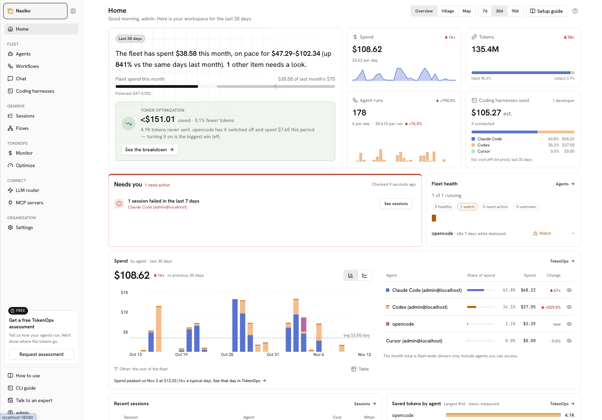
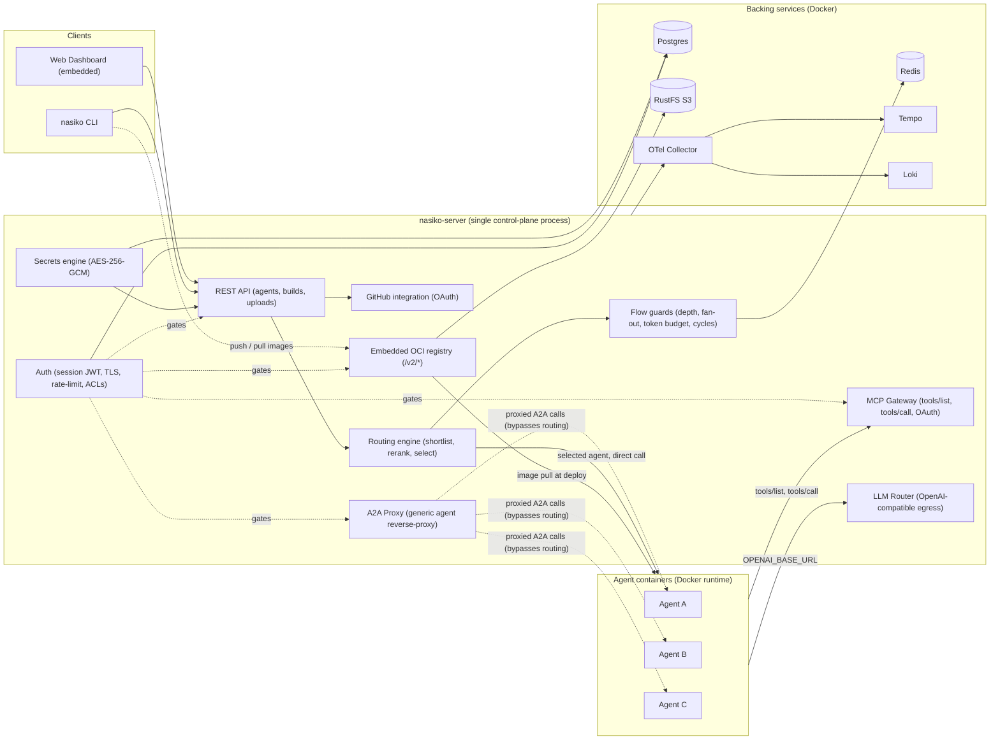

**Nasiko is the OpenRuntime for AI agents.**<br />
See every coding agent your team runs and what it costs. Route it to the models you choose. Then deploy and govern your own agents on the same runtime.

**[📚 Documentation](https://docs.nasiko.com)**  •  **[💬 Discord](https://discord.com/invite/HmnfkTfjFv)**  •  **[🐛 Report a bug](https://github.com/Nasiko-Labs/nasiko/issues)**

[](https://github.com/Nasiko-Labs/nasiko/stargazers)
[](https://github.com/Nasiko-Labs/nasiko/network/members)
[](https://github.com/Nasiko-Labs/nasiko/releases)
[](https://github.com/Nasiko-Labs/nasiko/blob/main/LICENSE)

[](https://github.com/Nasiko-Labs/nasiko)
[](https://github.com/Nasiko-Labs/nasiko/issues)
[](https://github.com/Nasiko-Labs/nasiko/pulls)
[](https://github.com/Nasiko-Labs/nasiko/actions)
[](https://github.com/Nasiko-Labs/nasiko/pulls)

## Table of Contents

- [Why Nasiko](#why-nasiko)
- [Features](#features)
- [Architecture](#architecture)
- [Quick start](#quick-start)
- [Coding agents](#coding-agents)
- [Deploy your own agents](#deploy-your-own-agents)
- [Troubleshooting](#troubleshooting)
- [Community](#community)

## Why Nasiko

Your developers already run coding agents: Claude Code, Codex, Cursor, OpenCode, often several at
once, each with its own dashboard and billing. At the end of the month nobody can say who spent
what, on which model.

Nasiko finds those agents, puts their spend in one place, and gives you back the model choice.
Your cost history, policy and model choice stay with you, not with any one vendor.

- **Non-invasive.** Discovery changes nothing. Reporting and routing are opt-in, with no wrapper
  or SDK in your code.
- **Non-intrusive.** After a one-time setup, developers keep using their harness exactly as before.



## Features

### Your coding agents

| Feature               | What it does                                                                                          |
| --------------------- | ----------------------------------------------------------------------------------------------------- |
| **Discovery**         | Finds Claude Code, Codex, OpenCode and Cursor CLI on a machine. Read-only: no account, nothing sent. |
| **Session reporting** | Every completed turn, with its tokens and cost, lands in one dashboard. Past sessions are imported.  |
| **Model routing**     | Point a harness at Nasiko instead of its vendor. Claude Code can run on your OpenAI key.             |

### TokenOps

| Feature                   | What it does                                                                                               |
| ------------------------- | ---------------------------------------------------------------------------------------------------------- |
| **LLM Router**            | Agents get a short-lived token, never a real API key. Provider, model and key are resolved on the server. |
| **Cost attribution**      | Usage and cost per agent and per model, instead of one provider invoice you have to reverse-engineer.     |
| **Token optimization**    | Compresses large payloads, compacts tool schemas and picks which chat history a request carries. Every saving is recorded. |
| **One trace per request** | Every hop emits an OTel span, so a request is one end-to-end trace with its cost attached.               |

### Policy and governance

| Feature                     | What it does                                                                                            |
| --------------------------- | ------------------------------------------------------------------------------------------------------- |
| **Single ingress**          | Agents are never publicly reachable. Every agent-to-agent call goes through the server.                 |
| **Access control**          | Ownership and grants for people, plus an allowlist for which agents may call which.                     |
| **MCP Gateway**             | One URL gives each agent the tools it was granted. Credentials stay with the gateway, never the agent. |
| **Human in the loop**       | Set a tool to **ask** and the agent pauses until someone approves it.                                   |
| **Flow guards**             | Limits on depth, fan-out, token budget and cycles stop runaway agent loops.                             |
| **Encrypted secrets**       | Per-agent secrets are encrypted at rest with AES-256-GCM and injected at deploy.                        |

### Orchestration

| Feature                     | What it does                                                                                     |
| --------------------------- | ------------------------------------------------------------------------------------------------ |
| **Deploy any A2A agent**    | `nasiko deploy` builds, pushes and runs it. No proprietary format and no SDK.                    |
| **Routing engine**          | Picks the right agent for a request in three stages: embedding shortlist, rerank, LLM selection. |
| **Built-in registry**       | An embedded, S3-backed OCI registry, so nothing external is needed to push and deploy.           |

## Architecture

To attribute spend across vendors and enforce a budget or a tool rule, Nasiko has to sit where the
calls happen. So it runs as a **single server process** that every agent call passes through, with
state in **Postgres**, **Redis** and **S3** (RustFS) and traces in **Tempo / Loki / OTel**.



Agents never receive a direct public request, and they call the LLM Router and MCP Gateway instead
of holding real API keys or tool credentials.

## Quick start

You need [Docker](https://docs.docker.com/get-docker/) with Compose V2 for the server. The CLI alone
is enough to discover coding agents. On Linux, add yourself to the `docker` group first:
`sudo usermod -aG docker "$USER"`, then log out and back in.

**1. Install the CLI**

```sh
# macOS and Linux
curl -fsSL https://registry.nasiko.dev/r/nasiko/install | bash

# Windows (PowerShell)
irm https://registry.nasiko.dev/r/nasiko/install-ps1 | iex
```

Or build it from source with Rust 1.85+: `cargo install --path cli/ --force`.

**2. Start the server**

```sh
git clone https://github.com/Nasiko-Labs/nasiko.git && cd nasiko
cp .env.example .env
docker compose up -d
```

The first build compiles the server inside Docker and takes a few minutes. Then open
**[http://localhost:8080](http://localhost:8080)** and log in as `admin` / `changeme`.

The `.env` defaults work on your own machine. Before anyone else can reach the server, change these:

| Variable                 | Set it to                                                    |
| ------------------------ | ------------------------------------------------------------ |
| `SECRETS_ENCRYPTION_KEY` | `openssl rand -base64 32`, once. A new key can't read old secrets. |
| `JWT_SECRET`             | `openssl rand -base64 48`                                    |
| `AGENT_JWT_SECRET`       | another `openssl rand -base64 48`, different from the one above |
| `ADMIN_PASSWORD`         | anything but `changeme`                                      |
| `OPENAI_API_KEY`         | your key, for dashboard chat, the routing engine and deployed agents |

After editing `.env`, run `docker compose up -d` again. Every variable is described in
[`server/.env.example`](server/.env.example).

```sh
docker compose logs -f server   # follow the server logs
docker compose down             # stop everything
docker compose up -d --build    # rebuild after pulling new changes
```

**3. Connect the CLI**

```sh
nasiko connect http://localhost:8080
nasiko auth login                 # admin / changeme, or your ADMIN_PASSWORD
```

Now [measure and route your coding agents](#coding-agents) or
[deploy your own](#deploy-your-own-agents).

### Run from source

Working on Nasiko itself? Run the server natively with hot-reload. This needs Rust 1.85+,
[`just`](https://github.com/casey/just) and Docker for the backing services:

```sh
just infra    # Postgres, Redis, RustFS and the OTel stack in Docker
just dev      # the server, rebuilt on every change (cargo install cargo-watch)
```

To see coding-agent tokens and cost on a native server, set
`CODING_AGENT_OTLP_ENDPOINT=http://localhost:4318` in `server/.env` (Compose sets it for you).
Toolchain setup, tests and code layout are in [CONTRIBUTING.md](CONTRIBUTING.md).

## Coding agents

Reporting and routing are separate opt-ins. Use either or both.

| Harness     | Discovery and reporting | Model routing |
| ----------- | ----------------------- | ------------- |
| Claude Code | yes                     | yes           |
| Codex       | yes                     | yes           |
| OpenCode    | yes                     | yes           |
| Cursor CLI  | yes                     | not yet       |

Want another harness? [Open an issue](https://github.com/Nasiko-Labs/nasiko/issues).

### Discover

Works before you have a server or an account:

```sh
nasiko agents discover
```

```text
AGENT      DETECTED   CONNECTED   VERSION   CONFIG
claude     yes        no          v4        ~/.claude
codex      yes        no          v2        ~/.codex
opencode   -          no          -         ~/.config/opencode
cursor     yes        no          v2        ~/.cursor
```

### Report sessions

With the server running and the CLI signed in ([Quick start](#quick-start)), one command connects
every detected harness and imports its past sessions:

```sh
nasiko agents setup
```

Finish one turn in a connected harness, then check that it arrived:

```sh
nasiko sessions                  # recorded sessions
nasiko agents status             # import progress
```

Add `nasiko agents install claude --no-content` first to keep prompt and response text out.
Codex asks you to trust the new hooks on its next start, and OpenCode needs a restart.
[How reporting works](https://docs.nasiko.com/coding-agents/session-reporting).

### Route models

Register a provider key once, then point a harness at Nasiko. Claude Code's requests can then be
served by your OpenAI key:

```sh
nasiko llm-config create --name my-openai --provider openai --model gpt-4o \
  --api-key-secret OPENAI_API_KEY --secret-value "$OPENAI_API_KEY"
nasiko connect claude --config my-openai
```

`connect codex` and `connect opencode` work the same way, and `nasiko disconnect <agent>` undoes
it. The key stays encrypted on the server; the harness only gets a short-lived token. Settings are
per user, so connecting affects every session of that harness on the machine.
[What `connect` changes](https://docs.nasiko.com/coding-agents/routing).

## Deploy your own agents

Nasiko runs any agent that speaks [A2A](https://github.com/a2aproject/a2a-spec) v1.0, in Python,
Rust, Go or TypeScript. There is no SDK to adopt.

```sh
nasiko new openai my-agent && cd my-agent   # scaffold from a template
nasiko deploy .                             # build, push and deploy
nasiko chat --agent my-agent "Hello there"
```

Deployed agents use the server's `OPENAI_API_KEY` unless you give them their own with
`nasiko secrets set`, so set it in `.env` before you chat.

`nasiko deploy` builds locally with Docker. `nasiko upload` sends the source and the server builds it.
You can also deploy from the dashboard: upload source, import from GitHub, or pull from the registry.

| Command                                      | What it does                              |
| -------------------------------------------- | ----------------------------------------- |
| `nasiko ps`                                  | List running agents                       |
| `nasiko logs <agent> -f`                     | Follow an agent's logs                    |
| `nasiko stop` / `start` / `restart` / `scale` | Agent lifecycle                          |
| `nasiko rm --name <agent>`                   | Remove an agent                           |
| `nasiko secrets set`                         | Store encrypted per-agent secrets         |
| `nasiko mcp`                                 | Manage tools and tool permissions         |
| `nasiko observe`                             | Sessions, traces, stats and spend         |

Run `nasiko <command> --help` for every option.

### Give your agent tools

Each deployed agent reaches its tools through the MCP Gateway and only sees what it was granted:

```sh
nasiko mcp connect --toolkit github                                         # connect your account
nasiko mcp agent-tools enable my-agent <connector-id>                       # grant it to my-agent
nasiko mcp agent-tools set-rule my-agent <connector-id> "GITHUB_DELETE_*" ask   # allow | ask | block
```

Bring your own MCP server with `nasiko mcp connector register <name> <url>`.
[Connect your agent to the gateway](https://docs.nasiko.com/build/mcp/agent-integration).

### Pause for a human

An agent can stop mid-task to ask a question or wait for a tool approval, then resume the same task
with the answer. It's plain A2A, shown in dashboard **Chat** and `nasiko chat`.
[Pause for a human](https://docs.nasiko.com/build/human-in-the-loop).

> **Try it:** `nasiko upload agents/general-assistant-1.1.1.zip` deploys a complete example that
> uses MCP tools and pauses for approval. Type `hitl input test` to see a pause without an LLM key.

## Troubleshooting

| Problem                                          | Fix                                                                                     |
| ------------------------------------------------ | --------------------------------------------------------------------------------------- |
| `permission denied` on the Docker socket         | Start Docker Desktop, or on Linux: `sudo usermod -aG docker "$USER" && newgrp docker`   |
| Server can't reach Postgres                      | Wait until `docker compose ps` shows `healthy`                                          |
| `.env` changes have no effect                    | Run `docker compose up -d`, not `restart`                                               |
| `address already in use` (9000, 4317, 4318)      | Find the process with `lsof -i :9000`; on Windows keep one Docker engine and `wsl --shutdown` |
| Agent can't reach the MCP gateway (Linux)        | Add `--add-host host.docker.internal:host-gateway`, or set `MCP_GATEWAY_PUBLIC_URL` to the bridge IP |

More: [server](https://docs.nasiko.com/self-hosting/troubleshooting) and
[coding agents](https://docs.nasiko.com/coding-agents/troubleshooting).

## Community

- **Docs:** [docs.nasiko.com](https://docs.nasiko.com)
- **Discord:** [join the community](https://discord.com/invite/HmnfkTfjFv) for questions and ideas
- **Contributing:** [CONTRIBUTING.md](CONTRIBUTING.md) covers local setup, conventions and the PR flow
- **Design docs:** [`docs/`](docs/) for the A2A protocol, MCP gateway internals and CLI design

[](https://github.com/Nasiko-Labs/nasiko/stargazers)
[](https://github.com/Nasiko-Labs/nasiko/commits)
[](https://github.com/Nasiko-Labs/nasiko/pulls)

[](https://github.com/Nasiko-Labs/nasiko/stargazers)
[](https://github.com/Nasiko-Labs/nasiko/commits)
[](https://github.com/Nasiko-Labs/nasiko/pulls)

Licensed under **Apache-2.0**. See [LICENSE](LICENSE). Stars, issues and PRs are always welcome.
