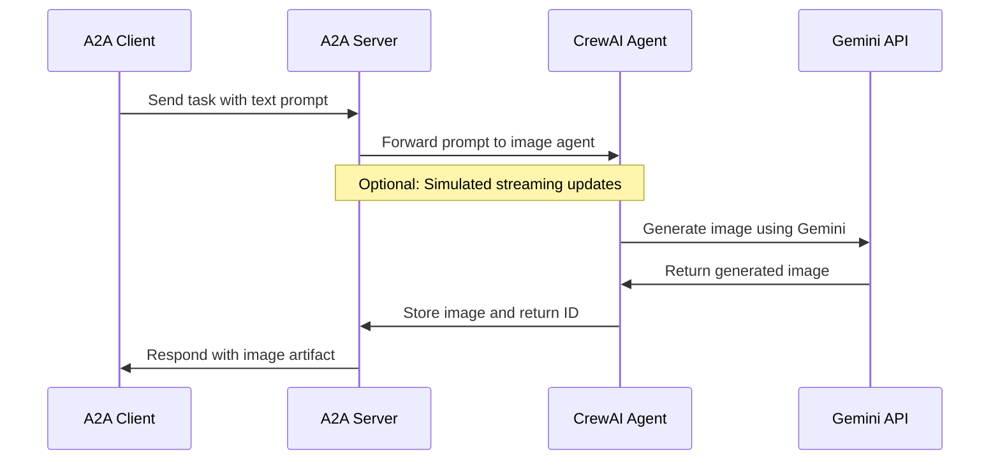

# CrewAI Agent with A2A Protocol

This sample demonstrates a simple image generation agent built with [CrewAI](https://www.crewai.com/open-source) and exposed through the A2A protocol.

## How It Works

This agent utilizes CrewAI and the Google Gemini API to generate images based on text prompts. The A2A protocol enables standardized interaction with the agent, allowing clients to send requests and receive images as artifacts.



## Key Components

- **CrewAI Agent**: Image generation agent with specialized tools; the crew's own reasoning runs on
  `openai/gpt-4o`
- **A2A Server**: Provides standardized protocol for interacting with the agent
- **Image Generation**: Uses the Gemini API (`gemini-2.0-flash-exp`) to create images from text descriptions
- **Cache System**: Stores generated images in memory for retrieval within a session

## Configuration

| Variable | Required | Description |
|----------|----------|-------------|
| `OPENAI_API_KEY` | Yes | Key for the crew's LLM (`openai/gpt-4o`); the server refuses to start without it |
| `GOOGLE_API_KEY` | Yes | Gemini API key, read by the Google GenAI client for image generation |
| `HOST_OVERRIDE` | No | URL to advertise on the Agent Card instead of `http://<host>:<port>/` |

The agent listens on port `8000` (`src/__main__.py`, and the `Dockerfile`'s `CMD`).

## Run on Nasiko

From this directory, with the `nasiko` CLI connected and logged in (see the repository README):

```bash
nasiko secrets set OPENAI_API_KEY sk-...      # vault secrets reach every agent you own
nasiko secrets set GOOGLE_API_KEY AIza...
nasiko deploy .                               # build locally, push and deploy
# or, without local Docker: nasiko upload .   # the server builds it
```

## Run with Docker

```bash
docker build -t crewai-a2a-server .
docker run -p 8000:8000 \
  -e OPENAI_API_KEY=sk-... \
  -e GOOGLE_API_KEY=AIza... \
  crewai-a2a-server
```

The Agent Card is then at `http://localhost:8000/.well-known/agent-card.json`. Inside the
container the server binds `0.0.0.0`; run outside a container, `src/__main__.py` defaults to
`--host localhost --port 8000`.

## Features & Improvements

**Features:**

- Text-to-image generation using Google Gemini
- Support for modifying existing images using references
- Robust error handling with automatic retries
- Improved artifact ID extraction from queries

**Limitations:**

- No true streaming (CrewAI doesn't natively support it)
- Limited agent interactions (no multi-turn conversations)

## Learn More

- [A2A Protocol Documentation](https://a2a-protocol.org)
- [CrewAI Documentation](https://docs.crewai.com/introduction)
- [Google Gemini API](https://ai.google.dev/gemini-api)
