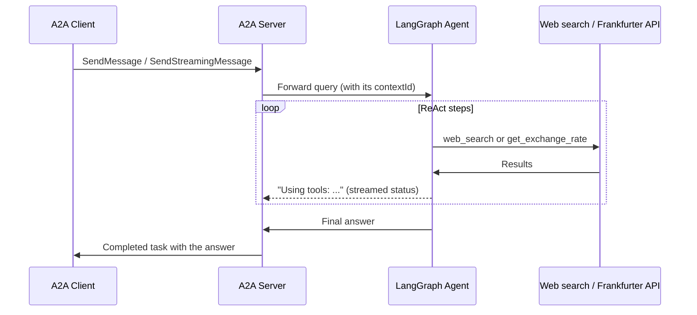

# LangGraph Deep Analyst Agent with A2A Protocol

This sample is a stateful, multi-step reasoning agent built with
[LangGraph](https://langchain-ai.github.io/langgraph/) and exposed through the A2A 1.0 protocol
(`a2a-sdk` 1.x). It answers analysis questions with two tools, a web search and currency exchange
rates, and supports multi-turn dialogue and streaming responses.

## How It Works

The agent is a LangGraph ReAct agent (`create_react_agent` in `src/agent.py`) over an
OpenAI-compatible chat model. It decides when to call its tools and streams progress back to the
client while it works.



## Key Features

- **Multi-turn Conversations**: Turns that share a `contextId` continue the same conversation
- **Real-time Streaming**: Provides status updates during processing
- **Conversational Memory**: A LangGraph checkpointer keeps each conversation's state between turns
- **Tools**: `web_search` (DuckDuckGo instant answers) and `get_exchange_rate` (Frankfurter API)

## Configuration

| Variable | Required | Description |
|----------|----------|-------------|
| `OPENAI_API_KEY` | Yes (or `DEEPSEEK_API_KEY`) | Key for the chat model; `DEEPSEEK_API_KEY` wins when both are set |
| `OPENAI_BASE_URL` | No | OpenAI-compatible endpoint; defaults to `https://api.deepseek.com/v1` |
| `OPENAI_MODEL` | No | Model name (`MODEL` is the older override); defaults to `deepseek-v4-flash` |
| `PORT` | No | Listen port when `--port` is not given; defaults to `8000` |
| `HOST_OVERRIDE` | No | URL to advertise on the Agent Card instead of `http://<host>:<port>/` |

To use OpenAI itself, set `OPENAI_BASE_URL=https://api.openai.com/v1` and an OpenAI model in
`OPENAI_MODEL`.

When the platform provides its state API (`NASIKO_STATE_URL` and `NASIKO_AGENT_TOKEN`, injected
on Nasiko), tasks and checkpoints are kept there and survive restarts. Without it the agent uses
in-memory stores, so memory lasts only as long as the process.

## Run on Nasiko

From this directory, with the `nasiko` CLI connected and logged in (see the repository README):

```bash
nasiko secrets set OPENAI_API_KEY sk-...      # vault secrets reach every agent you own
nasiko deploy .                               # build locally, push and deploy
# or, without local Docker: nasiko upload .   # the server builds it
```

## Run with Docker

```bash
docker build -t langgraph-a2a-server .
docker run -p 8000:8000 \
  -e OPENAI_API_KEY=sk-... \
  -e OPENAI_BASE_URL=https://api.openai.com/v1 \
  -e OPENAI_MODEL=gpt-4o-mini \
  langgraph-a2a-server
```

The server binds `0.0.0.0:8000`; the Agent Card is at
`http://localhost:8000/.well-known/agent-card.json`.

## Example

A synchronous request in the A2A 1.0 wire format (see
[A2A_PROTOCOL.md](../../docs/A2A_PROTOCOL.md) for the full format, streaming and multi-turn):

```bash
curl -s http://localhost:8000/ \
  -H 'Content-Type: application/json' \
  -H 'A2A-Version: 1.0' \
  -d '{
    "jsonrpc": "2.0",
    "id": "1",
    "method": "SendMessage",
    "params": {
      "message": {
        "messageId": "msg-1",
        "role": "ROLE_USER",
        "parts": [{ "text": "How much is 10 USD in INR?" }]
      }
    }
  }'
```

To continue the conversation, send the next message with the same `contextId` the response
returned.

## Limitations

- Only supports text-based input/output (no multi-modal support)
- The Frankfurter API covers a limited set of currencies

## Learn More

- [A2A Protocol Documentation](https://a2a-protocol.org/)
- [LangGraph Documentation](https://langchain-ai.github.io/langgraph/)
- [Frankfurter API](https://www.frankfurter.app/docs/)

## Disclaimer

Important: The sample code provided is for demonstration purposes and illustrates the mechanics of the Agent-to-Agent (A2A) protocol. When building production applications, it is critical to treat any agent operating outside of your direct control as a potentially untrusted entity.

All data received from an external agent—including but not limited to its AgentCard, messages, artifacts, and task statuses—should be handled as untrusted input. For example, a malicious agent could provide an AgentCard containing crafted data in its fields (e.g., description, name, skills.description). If this data is used without sanitization to construct prompts for a Large Language Model (LLM), it could expose your application to prompt injection attacks.  Failure to properly validate and sanitize this data before use can introduce security vulnerabilities into your application.

Developers are responsible for implementing appropriate security measures, such as input validation and secure handling of credentials to protect their systems and users.
