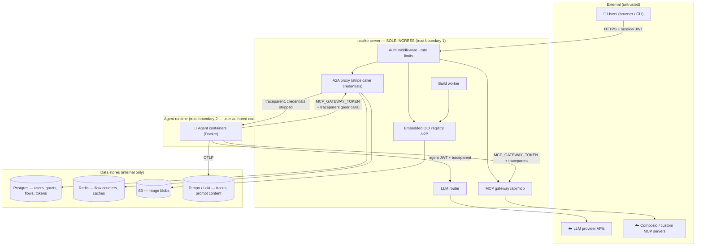

# Nasiko Threat Model (OSS Edition)

**Scope:** the open-source control plane — server, routing engine, MCP gateway, LLM router,
embedded OCI registry, auth, flow guard, secrets, CLI, Docker runtime, coding-agent harness
shim, and the web UI. Single-tenant self-hosted deployments.
**Method:** STRIDE over the data-flow diagram, ranked by likelihood × impact.
**Companion:** [`INCIDENT_RESPONSE.md`](INCIDENT_RESPONSE.md). Review on every new route group,
credential type, data store, or trust boundary.

## 1. System & trust boundaries

**Assets, in order:** data in Postgres/Redis/S3; agent secrets (AES-256-GCM at rest) and per-user
MCP credentials; LLM provider API keys (not held by agents when the LLM router is configured —
`AGENT_JWT_SECRET` and `LLM_GATEWAY_BASE_URL` set; otherwise the platform `OPENAI_API_KEY` is
injected into agents unless `AGENT_PLATFORM_KEY_FALLBACK=false`); availability of the
control plane (sole ingress — down means every agent unreachable).

**Attacker profiles:** external unauthenticated attacker; malicious authenticated user;
compromised or malicious agent container (user-authored code — the core assumption); malicious
MCP server; supply-chain attacker via PR or dependency.

## 2. Existing controls

| Control | Where |
|---|---|
| Single ingress; agents never publicly exposed; all A2A traffic proxied | `server/` |
| Session JWT auth; fixed-window rate limits (A2A 30/min, login 30/min, OCI 300/min, password change 10/min) | `server/` |
| User→agent ACL (`agent_grants`) + agent→agent allowlist (`agent_acl`) | `server/src/acl.rs` |
| FlowGuard cascade limits (depth, fan-out, token budget, timeout, cycles), Redis-backed, **fails closed** | `flow/` |
| Proxy strips `Authorization`/`Cookie` before forwarding to agents | `server/src/agent_proxy.rs` |
| Agent secrets AES-256-GCM at rest, decrypted only into container env at deploy | `secrets/` |
| LLM router (when `AGENT_JWT_SECRET` and `LLM_GATEWAY_BASE_URL` are set): per-agent identity JWTs instead of provider keys; strict traceparent attribution (no flow → 403, no fallback) | `llm-router/`, `server/src/llm_router/wiring.rs` |
| Agent credential (`MCP_GATEWAY_TOKEN`, `ngt_…`) for the MCP gateway and agent→peer calls on `/api/agents/{id}/*`: hashed, rotated on redeploy (the old one keeps working for a 15-minute grace), revoked at once by `DELETE /api/agents/{id}/mcp-token` or on destroy; flow-participant binding; all rules fail closed | `mcp-gateway/src/agent_tokens.rs`, `server/src/auth/agent_caller.rs` |
| MCP SSRF guard: registration-time + connect-time DNS pinning (rebinding-hardened) for user-supplied connector URLs; exempt by design: platform-built uploaded servers and platform-owned `system` connectors, whose addresses the platform resolves itself | `mcp-gateway/src/net.rs` |
| OCI registry three-way auth; Basic identities structurally cannot reach session routes | `server/src/lib.rs` |
| Build concurrency caps + per-target serialization | `server/src/agents/build_worker.rs` |
| MCP connections to user-registered servers never reused across callers | `mcp-gateway/` |
| Shared agents run on the caller's LLM config and MCP connections | `llm-router/`, `server/` |
| Every rate-limit 429 carries `Retry-After` | `server/` |
| Coding-agent usage reports carry tokens, cost, latency, models, tools and subagents, never conversation; chat history syncs only where the server keeps it (`CODING_AGENT_CHAT_HISTORY`) and only after the user consents; harness sessions off by default (`HARNESS_SESSIONS_ENABLED`) | `cli/src/commands/integration/{report,sync,locality}.rs`, `server/src/coding_agent_*.rs` |

## 3. Top threats (STRIDE)

### P0 — address now / verify continuously

| # | Threat | STRIDE | Mitigation | Gap / action |
|---|---|---|---|---|
| T1 | **Malicious agent escapes its identity** — stolen `MCP_GATEWAY_TOKEN` (MCP gateway and agent→peer calls)/LLM JWT, replayed `traceparent` | EoP, Info | Flow-participant check binds (agent, flow, user); credential rotates on redeploy (15-minute grace for the old one), `DELETE /api/agents/{id}/mcp-token` or destroy revokes it at once | Participant insert must exist on **every** dispatch path (proxy, a2a dispatch, react-agent tool, MAF executor) — the integration tests asserting it are load-bearing |
| T2 | **Auth bypass** — JWT forgery, middleware gap on a new route, Basic→JWT fallthrough on `/v2/*` | Spoofing, EoP | Single middleware stack; Basic never falls through | Every new route must sit behind the correct guard; a route-inventory test should assert no unauthenticated route beyond the known public set |
| T3 | **SSRF** via custom MCP server URL, GitHub clone, registry import | Info, Tampering | Registration-time + connect-time DNS pinning for user-supplied connector URLs (platform-built uploaded servers and `system` connectors are exempt — their addresses never come from a user); `GIT_CLONE_ALLOWED_HOSTS`, `REGISTRY_IMPORT_ALLOWED_HOSTS` | Any **new** outbound-URL feature must reuse the guard, not reimplement it; nothing user-supplied may set the `trusted` exemption |
| T4 | **Postgres compromise = impersonation** — the `flows` table is an authentication authority for MCP + LLM router | Info, EoP | DB never publicly exposed; single ingress | Accepted trust placement (see [`MCP_GATEWAY_DESIGN.md`](MCP_GATEWAY_DESIGN.md)). Operators: least-privilege DB roles, encrypted backups |
| T5 | **Build RCE / resource exhaustion** — malicious Dockerfile via `upload`; build context following symlinks into host files | EoP, DoS | Panic-isolated build tasks, `BUILD_CONCURRENCY` cap, per-target serialization | Treat the build worker as a hostile-code sandbox; never follow symlinks out of the build context |
| T16 | **Sign-in account adoption / admin bootstrap** — external-identity (GitHub OAuth) first sign-in matching an existing local username; `initialize-admin` reopening or racing | Spoofing, EoP | Session JWT auth | Link external identities only by provider subject; bootstrap only while no privileged user exists, atomically |
| T17 | **Cross-owner registry write** — same or slug-equal agent names, unclaimed derived repos | Tampering, EoP | Three-way registry auth | Claim every derived repo at creation; reserve platform agent names |
| T18 | **SSRF via stored agent URL** — proxy relaying to an arbitrary `agents.url` | Info | Single ingress | Validate stored URLs with the same SSRF guard (T3) |

### P1 — serious, bounded blast radius

| # | Threat | STRIDE | Mitigation | Gap / action |
|---|---|---|---|---|
| T6 | **Runaway agent cascade** (DoS / token-cost explosion) | DoS | FlowGuard depth/fan-out/token/timeout/cycle limits, fail-closed on Redis outage | Fail-closed on Redis down is an availability tradeoff — alert on `GuardUnavailable` spikes |
| T7 | **Prompt content in observability** — `gen_ai.*` message content in Tempo/Loki; `MCP_GATEWAY_CONNECT_URL` credential can land in agent-side `url.full` spans | Info | Server redacts credential URIs; header form is the documented default | Agent-side spans are not ours to redact (accepted tradeoff). Operators: access-control + retention on Tempo/Loki |
| T8 | **MCP credential theft by a malicious custom server** | Info, Spoofing | Per-user credentials; owner-controlled sharing; revocation deletes the grantee's connection row in the same transaction | A server inherently sees its own callers' credentials *for that server* — vet connectors before sharing widely |
| T9 | **OAuth state replay / CSRF** on login and MCP OAuth callbacks | Spoofing | Signed `state`, PKCE, single-use | Replay checks must fail closed when their store is down |
| T10 | **Supply chain** — malicious PR or dependency | Tampering | Review, pinned deps | Run `cargo audit` in CI; scrutinize PRs touching auth, ACL, dispatch |
| T11 | **Login brute force / pre-identity DoS** | DoS, Spoofing | Fixed-window limits per endpoint group | The shared pre-identity bucket can be DoS'd to lock out logins — monitor; consider per-IP keying |
| T19 | **Provider keys used across owners** — ownership transfer, soft-deleted agents, agent JWTs without their own audience | EoP, Info | Flow-participant check | Resolve keys by current owner; reject deleted agents; separate agent-token audience |
| T20 | **Cross-user session or trace access** — client-chosen session ids; agent-emitted `session.id` deciding trace ownership | Info, Tampering | Session auth | Enforce session ownership on every dispatch; derive trace ownership server-side |
| T21 | **Tokens in logs** — session tokens in query strings recorded by request spans | Info | Credential-URI redaction | Redact query tokens in spans and logs |
| T23 | **Coding-agent conversation leakage** | Info | Usage-only reports; consent-gated chat history | Keep consent path tested |

### P2 — accepted / monitor

| # | Threat | Decision |
|---|---|---|
| T12 | In-progress OCI chunked uploads held in memory (sticky pushes) | Accepted; restart loses an in-flight push, client retries |
| T13 | Agent background work (no flow) rejected by MCP/LLM router | Deliberate — becomes an explicit owner-billed feature if ever wanted, never a silent fallback |
| T14 | Trace ids visible in traces | By design; useless without the agent credential (participant check) |
| T15 | Bootstrap admin default password `changeme` | Not enforced by the server; the README quick start says to change `ADMIN_PASSWORD` before anyone else can reach it |

## 4. Verification loop

- **Per-change:** PRs touching auth middleware, ACL, dispatch paths, or outbound-URL features
  state which threat row they affect.
- **Per-release:** re-run this model when adding a route group, credential type, data store, or
  trust boundary.
- **Continuously:** the integration tests named in the MCP gateway and token-attribution docs are
  the executable half of this model — weakening them voids it.
- **Trouble metrics:** `GuardUnavailable` spikes, LLM-router 403 storms (agents dropping
  `traceparent`), OCI 401 bursts.

*Last full review: 2026-11-12.*
